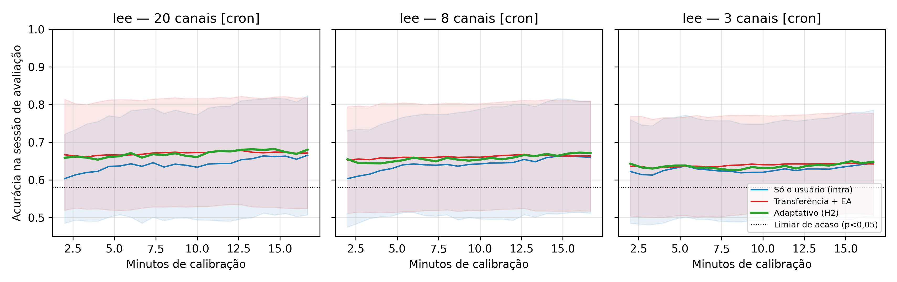

# BCI com poucos canais: calibração curta e limites de critérios de parada

Pesquisa independente sobre **interfaces cérebro-computador (BCI) de imagética motora**: quantos
eletrodos e quanto tempo de calibração um usuário novo precisa, e se **critérios de parada
adaptativos** (que encerram a calibração quando o classificador "estabiliza") conseguem encurtá-la
sem perda de acurácia.

- **Autor:** Breno Luiz Silva do Carmo, Instituto Federal Fluminense (IFF), Campus Bom Jesus do Itabapoana
- **Resumo aceito** no 10º CONINF (IFF Itaperuna, 2026): [`docs/resumo_coninf_2026.pdf`](docs/resumo_coninf_2026.pdf)

## Pergunta

Uma BCI de imagética motora precisa ser calibrada para cada usuário novo: ele imagina movimentos da
mão esquerda e da direita por vários minutos antes de usar o sistema. Montagens com poucos eletrodos
são mais baratas, mas costumam exigir ainda mais calibração. Este trabalho mede:

1. quanto a **transferência entre usuários** (alinhamento euclidiano) encurta a calibração, com
   montagens completa, de 8 e de 3 canais;
2. se **critérios de parada adaptativos** por usuário superam um **orçamento fixo** de tentativas.

## Dados

Três bases públicas, duas sessões por participante, classes mão esquerda × mão direita (72 pessoas):

| Base | Participantes | Canais | Papel |
|---|---:|---|---|
| BCI Competition IV 2a | 9 | 22 | desenvolvimento |
| BCI Competition IV 2b | 9 | 3 (C3, Cz, C4) | primeiro teste independente |
| Lee2019 (OpenBMI) | 54 | 20 sobre o córtex motor | teste principal |

Os dados são baixados automaticamente pelo [MOABB](https://moabb.neurotechx.com/); nenhum dado
bruto fica neste repositório.

## Método

- Filtro de 8–30 Hz, janela de 0,5–2,5 s após a pista visual.
- Covariâncias com encolhimento OAS → **alinhamento euclidiano** (He e Wu, 2020) → **CSP + LDA**.
- **Deixa um sujeito de fora**: a 1ª sessão do usuário novo é a calibração; a 2ª serve só como teste.
- As tentativas de calibração entram **na ordem real de gravação** (`--ordem=cron`), como numa sessão ao vivo.
- Condições: só dados do usuário (**intra**), dados dos outros participantes + do usuário
  (**transferência**) e um seletor entre os dois por validação cruzada (**adaptativa**).
- Critérios de parada: platô da acurácia prequencial, platô da validação cruzada e extrapolação da
  curva de aprendizado, comparados com orçamentos fixos (40 e 80 tentativas) e com um oráculo.
- **Parâmetros fixados antes** de rodar nas bases de teste (2b e Lee2019).
- Estatística: Wilcoxon pareado por participante com correção de **Holm**; IC95% por t pareado;
  equivalência por **TOST** com margem de ±5 pontos percentuais (Lakens, 2017).

## Resultados principais

Diferenças de acurácia em pontos percentuais [IC95%]. Transf.: transferência; intra: só dados do usuário.

| Base (n) | Transf. − intra (20 tentativas) | Transf. 40 tent. − intra completa | 8 canais − completa (transf.) | 3 canais − completa (transf.) |
|---|---|---|---|---|
| Lee2019 (54) | +4,1 [+1,4; +6,9]; p_Holm = 0,03 | +0,3 [−1,9; +2,4]; **equivalente** | −0,8 [−2,4; +0,7]; **equivalente** | −2,9 [−4,7; −1,1]; **equivalente** |
| IV 2a (9) | +0,5 [−6,0; +7,1]; p_Holm = 1,00 | −5,2 [−11,6; +1,1]; inconclusivo | −2,2 [−5,3; +0,8]; **equivalente** | −8,3 [−11,1; −5,4]; inconclusivo |
| IV 2b (9) | +9,4 [+0,1; +18,7]; p_Holm = 0,15 | +2,7 [−1,3; +6,7]; inconclusivo | não se aplica | não se aplica |

- **Calibração mais curta:** no Lee2019, a transferência com 40 tentativas (~6,7 min) ficou dentro da
  margem de equivalência em relação à calibração completa só com dados do usuário (100 tentativas),
  nas três montagens.
- **Poucos canais:** com transferência, 8 canais foram equivalentes à montagem completa no Lee2019 e na 2a.
- **Critérios de parada (resultado negativo):** nenhum critério superou o orçamento fixo de 40
  tentativas após a correção de Holm, em nenhuma base. No Lee2019, o ponto de parada não acompanhou o
  ótimo de cada participante: |ρ de Spearman| < 0,3 com o oráculo nas 27 combinações (mediana +0,05).
- **Por quê:** entre 32 e 48 tentativas, o ganho real de acurácia a cada 4 tentativas foi de −0,2 a
  +0,2 ponto, enquanto a validação cruzada oscilou de 3 a 8 pontos; a razão sinal/ruído não passou de
  0,04. Com 40 tentativas, o erro-padrão binomial da acurácia (~7,5 pontos) já é maior que o ganho de
  2 pontos que os critérios tentam detectar (Varoquaux, 2018).
- **Limitação:** no Lee2019, 17 a 21 dos 54 participantes, conforme a configuração, não superaram o
  acaso (limiar de 58% pelo teste binomial, α = 0,05).



A saída completa de cada base está em [`resultados/`](resultados): `cron_<base>_estatistica.txt`
(famílias de testes F1–F5), `cron_<base>_numeros_para_o_resumo.txt` e os CSVs por participante.

## Como reproduzir

```bash
python -m venv .venv
# Windows: .venv\Scripts\activate   |   Linux/Mac: source .venv/bin/activate
pip install -r requirements.txt

# BCI IV 2a e 2b (baixados pelo MOABB na primeira execução)
python experimento_eamc_v3.py 2a --ordem=cron
python experimento_eamc_v3.py 2b --ordem=cron

# Lee2019: primeiro baixa e guarda os 54 sujeitos em uma pasta; depois roda o experimento
python experimento_eamc_v3.py lee-baixar ./cache_lee2019
python experimento_eamc_v3.py lee ./cache_lee2019 --ordem=cron

# Estatística (lê os CSVs gerados acima, na pasta atual)
python analise_estatistica.py cron_2a cron_2b cron_lee
```

O Lee2019 é grande (54 sujeitos × 2 sessões); no Google Colab, use uma pasta do Google Drive como
cache, que é o padrão do script (`/content/drive/MyDrive/eamc_lee2019`).

## Arquivos

| Arquivo | O que faz |
|---|---|
| `experimento_eamc_v3.py` | carrega os dados, roda as trajetórias de calibração e os critérios de parada, gera CSVs e figuras |
| `analise_estatistica.py` | testes estatísticos (F1 a F5: transferência, equivalência, critérios de parada, poucos canais, limite de sinal/ruído) |
| `resultados/` | saídas usadas nos resumos (ordem real de gravação) |
| `docs/` | resumo aceito no 10º CONINF |

## Referências

- HE, H.; WU, D. Transfer learning for brain-computer interfaces: a Euclidean space data alignment approach. *IEEE TBME*, 67(2), 2020.
- LAKENS, D. Equivalence tests: a practical primer for t tests, correlations, and meta-analyses. *SPPS*, 8(4), 2017.
- LEE, M.-H. et al. EEG dataset and OpenBMI toolbox for three BCI paradigms. *GigaScience*, 8(5), 2019.
- TANGERMANN, M. et al. Review of the BCI Competition IV. *Frontiers in Neuroscience*, 6, 2012.
- VAROQUAUX, G. Cross-validation failure: small sample sizes lead to large error bars. *NeuroImage*, 180, 2018.
